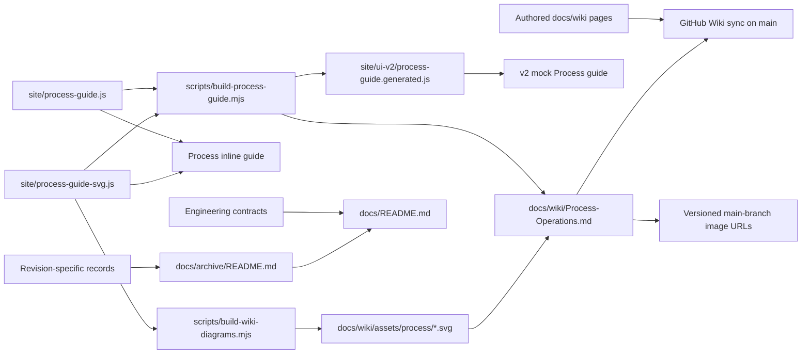

# Documentation architecture and maintenance

## Folder ownership and canonical references

- `docs/` owns stable navigation entrypoints and shared engineering conventions.
- `docs/science/` owns current process, geometry, annotation, unit-integrity and History transaction contracts.
- `docs/examples/` owns paper-based reconstructions, assumptions and validation provenance.
- `docs/ui-v2/` owns Workstation implementation contracts and dated engineering checkpoints.
- `docs/wiki/` stays flat for the Main-only GitHub Wiki publisher, with its SVG assets under `assets/`.
- `docs/archive/` owns frozen historical audits, handoffs and original review images under `archive/review/`; old evidence is not a current baseline.
- `docs/renderer/` owns 3D renderer contracts, open plans and dated technical evidence.
- `docs/io/` owns layout interchange and Process report contracts.
- `docs/tools/` owns offline diagnostic tooling, not production renderer alternatives.
- `docs/operations/` owns repository release/retirement administration.
- `docs/evidence/` owns research figure provenance and reproducibility registers.

When moving documentation, keep exactly one canonical file in the owning directory and update every tracked Markdown link, source reference and workflow path to that location. **Do not add forwarding Markdown stubs or compatibility ledgers for moved repository documents.** Retired localized Wiki pages are deleted instead of replaced with placeholder aliases; existing external bookmarks to deleted slugs may stop resolving. Current links must point to the canonical English page. Run the documentation link graph check and keep scientific provenance intact.

## Contract lifecycle

Every domain README distinguishes **current implementation contracts**,
**open experimental/forward plans**, and **historical evidence tied to a
revision**. A roadmap must actively reclassify a capability once a shipped
UI/controller/Worker implementation exists: do not continue calling
Process Geometry Diagnostics a proposed feature merely because its original
roadmap was written before release. Technical descriptions of a shipped feature live in one
current owner file, not scattered across merged-PR acceptance records.
Revision-specific test results, older DOM inventories, authoring
checkpoints and completed Draft/merge instructions belong in the
archive. Archive a file only after updating all inbound Markdown,
script and manual-workflow references (including legacy benchmark scripts),
preserving its original SHA and measured results;
do not create repository Markdown forwarding stubs.

Current domain owners are
[Workstation](ui-v2/WORKSTATION_CONTRACT.md),
[Renderer/Section](renderer/RENDERER_CONTRACT.md) and
[Continuous release](science/CONTINUOUS_RELEASE_CONTRACT.md).
Generated Process operations and SVGs must never be edited by hand.

## Authority and readers

**Documentation language:** English is required for new and actively maintained WaferCAD documentation, release notes, code comments, UI text, prompts and development handoffs. Existing historical audits, plans and archived handoffs may remain in their original language; do not translate them solely to standardize language. When retiring localized Wiki content, delete the obsolete page and point tracked navigation to its canonical English counterpart. Do not retain alias/stub pages solely for old bookmarks.

[The documentation map](README.md) is the repository navigation root. [The root README](../README.md) introduces the product and links here; it should summarize rather than duplicate implementation details.

| Layer                      | Source and purpose                                                                                                                                                       | Maintenance rule                                                                                                                                                        |
| -------------------------- | ------------------------------------------------------------------------------------------------------------------------------------------------------------------------ | ----------------------------------------------------------------------------------------------------------------------------------------------------------------------- |
| Product manual             | `docs/wiki/`: tasks, controls, Recipe syntax, examples and modeling limits                                                                                               | Authored pages describe shipped behavior; `Process-Operations.md` is generated. The Recipe tutorial and AI-assisted guide document the same parser contract in English. |
| Engineering contracts      | Architecture, Development, Testing, CI and the scientific/interchange documents linked from the map                                                                      | Own module boundaries, invariants and acceptance. Update the owning contract when behavior changes.                                                                     |
| Forward plans              | `docs/science/PROCESS_GEOMETRY_ROADMAP_2026-10-09.md`, `docs/science/MATERIAL_TARGET_SEMANTICS_2026-10-13.md`, Physical Facet research and Renderer transparency roadmap | Keep proposal, experimental prototype, shipped feature and historical evidence explicitly distinct; update this status when functionality becomes available.            |
| Revision-specific evidence | [Archive index](archive/README.md)                                                                                                                                       | Preserve dates, SHAs, environments and original results. Add a status/provenance banner rather than rewriting old measurements as current.                              |

PR descriptions own **current per-change status** (scope, validation and remaining work); PR comments own **dated diagnostic and review evidence**. Keep routine red/green CI reports, screenshots and handoffs there, not as new tracked Markdown. A repository file is justified for a cross-PR contract, scientific source/assumption, fixture reproduction, release/runbook obligation or reusable engineering decision. Before closing a PR, promote durable conclusions into its existing owning document and leave the supporting PR/CI link there when useful.

The implementation and meaningful regression tests establish shipped behavior. When a document disagrees with them, investigate and reconcile the owning contract; do not silently relax a test to agree with prose. A screenshot, chat or ignored artifact is supporting evidence, not a portable source of truth. Third-party research snapshots are not continuously verified vendor capability catalogs.

## Sources, generated content and publication

- Edit operation names/descriptions in `site/process-guide.js` and illustrations in `site/process-guide-svg.js`; run `npm run docs:build` and commit the generated operation reference **and all affected SVG assets** with their sources. The old `site/guide/` route is a compatibility redirect to the Wiki.
- The same command generates `site/ui-v2/process-guide.generated.js`, a classic-script bridge used only by the portable mock preview, including direct `file://` boot. Never hand-edit its catalog or diagrams. `docs:check` rejects bridge drift; `process-guide.test.mjs` compares all 20 Before/After pairs to the canonical modules. This does not connect production Process controllers or alter geometry.
- Edit other Wiki pages directly. For figures, use exact named-example WaferCAD assets or the canonical Process Guide schematics with source-aware captions; for interaction logic, prefer Mermaid. No generic filler images, unattributed article figures or unlabeled visual approximations. The [visual audit](archive/WIKI_CONTENT_VISUAL_AUDIT_2026-10-12.md) records the page-by-page decisions.
- `site/bundled-examples.js` owns the published Welcome catalog; its IDs, titles and DOI provenance must agree with the examples chapter.
- `docs/wiki/_Sidebar.md` and `Home.md` own manual navigation. Wiki-relative links omit `.md`; repository-relative links include real filenames. Use links, rather than inline code paths, when readers should open a file.
- [Wiki sync](WIKI_SYNC.md) owns credentials and managed-page replacement. [CI routing](CI.md) owns trigger behavior. Local Draft/Full verification **or** eligible verified-base incremental PR Quality owns the focused Process Guide, Wiki and navigation Node checks; the current CI policy determines which evidence route is available. The separate read-only documentation-targeted workflow is available by explicit manual dispatch, not automatic PR triggering; only the Main push Wiki workflow may publish content. Wiki checks also run on every Main push; referenced SVG assets are served from versioned repository files through main-branch raw URLs. Pages is independently path-filtered. A repository commit, a successful Wiki sync and a successful Pages deployment are distinct evidence.

## Change workflow

1. Identify the owning engineering contract and affected manual task, including the English Recipe tutorial and AI-assisted guide when syntax/units change.
2. Check the current implementation and relevant tests; preserve inferred-versus-source-reported scientific provenance.
3. Update authored pages, regenerate only derived content, and keep previous evidence revision-specific.
4. Use repository-relative source paths in handoffs. Remove or anonymize local home directories, personal workstation paths, authentication headers and tokens from logs and screenshots before committing; never rewrite third-party license attribution.
5. Add or update the map/archive link for a new **durable** document. All Markdown under `docs/` must be reachable through `docs/README.md` or its lifecycle/archive indices. Relocate **already committed** completed/superseded records to `docs/archive/` with valid relative links; do not commit fresh one-off reports just to archive them. Keep scientific provenance and referenced evidence discoverable. Do not rewrite historical results as current acceptance.
6. Run `npm run docs:check`, `npm run format:check`, and the focused documentation/guide tests. Code changes still require the checks owned by [Testing](testing.md).
7. Record the audited product SHA, exact commands/results and limits in the PR description, plus discrete evidence in PR comments/artifacts. Before final acceptance, consolidate any lasting decision into the owning repository document. Publish under the user's existing authorization and verify the remote revision; main publication is not proof that deployment finished.

## Automated checks and their limits

`npm run docs:check` checks generated operation output, managed manual pages, all tracked/new non-ignored Markdown internal destinations and headings, documentation reachability, current Architecture module paths, published Welcome links and atlas operation IDs. The standalone link/navigation gate is `node scripts/check-documentation.mjs` and uses only Node built-ins plus the existing application catalogs.

`site/tests/documentation/wiki-manual.test.mjs` checks the current catalog against `BUNDLED_EXAMPLES.length`, validates repository-owned images, and parses English Recipe and AI-assisted code examples. `site/tests/documentation/documentation.test.mjs` owns link/navigation parser and negative-fixture coverage. The root `site/tests/documentation-suite.test.mjs` entry point discovers those files for `npm test` and focused Wiki CI; the Wiki publishing workflow runs the same documentation checks before synchronization.

These checks cannot prove prose/scientific correctness, execute every example as a fabrication process, validate external DOI/vendor URLs, certify the live Wiki/Pages deployment, or accept pixel baselines. External research statements retain their recorded date; full replay and visual acceptance remain in their scientific/browser suites.
