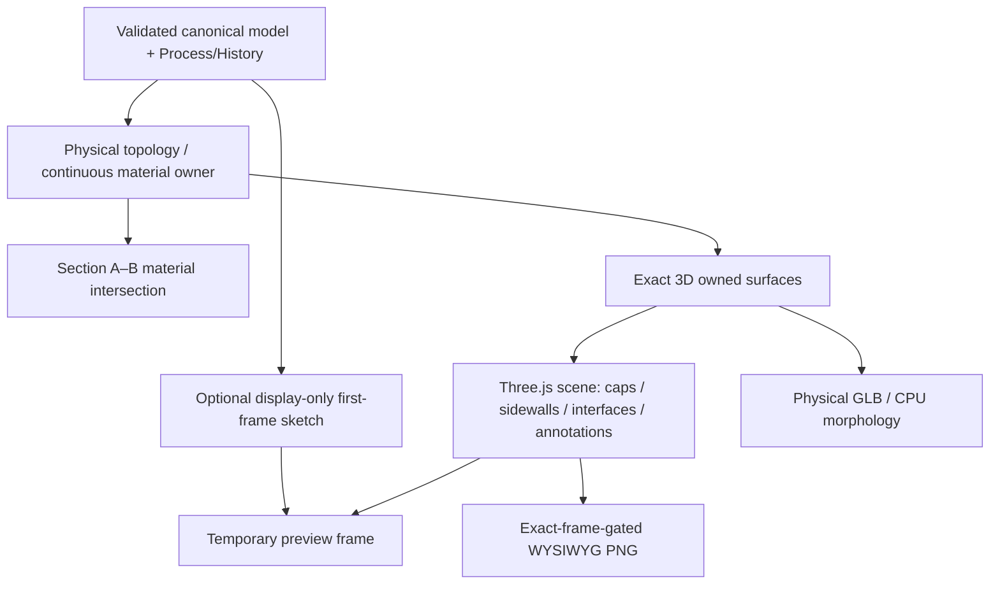

# Renderer, Section and capture contract

**Current product boundary, reviewed against `main@90fb168` (2026-10-24).**
This contract documents implemented **geometry versus presentation**
ownership; it does not assert a new physical-GPU benchmark or completed
original-paper microscopy match. Source and targeted tests override this
summary if the behavior changes.

## One canonical material owner, multiple views

The persisted process model, not a triangle mesh or screenshot, owns layer
identity, material occupancy, Z coordinates, process lineage and physical
geometry. Ordinary `vector-2.5d-v1` models use region stacks and
`site/process-topology.js` to derive exposed caps, real walls, buried
interfaces and Section slices. `site/renderer-geometry.js` consumes this
topology to build an _exact, derived_ surface-ownership plan. It must not
invent physical walls at computational polygon partitions. The
`vector-continuous-etch-v1` kernel has its separate analytic material
owner and consumers; see the
[Continuous release contract](../science/CONTINUOUS_RELEASE_CONTRACT.md).

Section and the physical 3D mesh are separate representations of the same
saved material owner. For a meaningful consistency comparison, align the
same model revision, XY cut, ROI and Z display policy; compare physical
material interfaces at the same coordinates, not differently sampled
rough/pyramid display relief. Electrical Region and Implant are annotations,
not added material or diffusion physics. Section clips continuous
annotations to surviving material; an unsupported Physical Facet annotation
must fail closed, not silently render outside the physical owner.

## Progressive first frame and exact handoff (#359)

`site/renderer-surface-plan-worker.js` may first stream a bounded
`renderer-progressive-preview.js` sketch: visible outer caps plus sampled
border lines, transferred as a typed position buffer. It is **display-only**,
not an exact Boolean/material owner, science query, collision input,
storage cache or export source. It may omit buried interfaces and resolved
intersections. Preview generation failures warn and continue to the exact
path. Array models and ROI-clipped models decline this sketch and take the
exact path; they must never display uncut proxy geometry.

The Worker then computes the deterministic exact owned surface plan,
streaming when appropriate. Abort, stale-revision and replacement checks
must prevent an obsolete plan from becoming the visible exact scene. A
preview may remain painted while replacement is pending, but only a
**painted exact frame** satisfies exact-first-frame readiness. Preview
and exact timings are separate diagnostics. `rendererProgressiveFirstFrameMs`
is not interchangeable with `rendererExactFirstFrameMs`.

`site/renderer-surface-plan-async.js` and
`site/renderer-surface-plan-stream.js` own async request and delivery
mechanics; the renderer retains the visible scene until a safe handoff.
For continuous material, `site/continuous-heightfield-mesh-worker.js`
and `site/continuous-heightfield-mesh.js` have a separate bounded
display-mesh path (#365), not permission to mutate saved source geometry.

## Physical rebuild, presentation update and rough LOD

`site/three-view.js` owns renderer lifecycle and the physical scene
fingerprint. Changing the canonical model/ROI or structural 3D policy
may require rebuilding owned caps, sidewalls, annotations and borders.
Opacity, outline visibility and other presentation-only changes should
reuse compatible existing geometry and material instances rather than
re-running geometry Booleans. A cache hit is valid only when material
revision and all physical/view clipping owners match; a restored
History state cannot reuse a stale ownership result merely because its
process count matches. Active and retained resource counts, draw calls,
drawn triangles and actual painted-frame serials are the observability
signals, not CPU plan-ready events alone.

Fast, Quality and transient Interactive 3D policies control **display**
tessellation, rough LOD and pixel ratio without modifying material
occupancy. Deterministic Rough/Pyramid profiles are presentation
morphology with shared material-surface registration. GPU-hybrid rough
caps are allowed for viewport presentation; GLB uses camera-independent
CPU morphology. LOD transitions must not create fake physical
interfaces, unsupported back lines or skirts across computational seams.
Shared interval/edge ownership lives in `site/line-intervals.js`,
`site/rough-mesh-geometry.js` and the topology owner. Inspect
Rough/Section consistency across more than one model height and ROI.

The 3D Display settings (October 2026) expose opacity, **uniform,
continuous** Z-display scale and Show Origin, with independent border
inspection. This changes presentation, **not** physical micrometre
coordinates, saved material thickness or GLB geometry. Avoid the retired
nonlinear per-surface relief inspector. Near-opaque transparency and
origin-axis/outline artifacts are part of the active presentation
regression surface (#367).

## ROI and export are different contracts

Main ROI limits 3D inspection and GLB clipping; Section A–B samples
its **own** XY line and does not automatically follow the ROI perimeter.
The Mask ROI instead constrains Process selection. Do not infer a
process etch from a 3D crop.

Where a material kernel supports physical GLB export, the output is
derived from exact canonical material ownership and camera-independent
deterministic geometry; unsupported special owners must fail explicitly
rather than exporting a display proxy. 3D PNG exports the **visible
exact 3D frame** at native 3× capture resolution; it reflects selected
opacity, borders, origin, scale and current rough LOD. It is a
presentation snapshot, not a measurement or material export.
`site/renderer-capture-transaction.js` rejects a preview-only scene
and isolates the temporary capture renderer/camera state. On failure,
restore interactive pixel ratio, aspect and scene, and report any
cleanup failure rather than corrupting the live viewport.

## Evidence, tests and open work

- Progressive preview, stream and Worker isolation:
  `site/tests/renderer-progressive-preview.test.mjs`,
  `site/tests/renderer-progressive-worker-isolation.test.mjs`,
  `site/tests/renderer-surface-plan-worker.test.mjs`.
- Capture transaction and exact-frame protection:
  `site/tests/renderer-capture-transaction.test.mjs`.
- Section/3D profile comparison:
  `site/tests/section-three-rough-profile.test.mjs`, plus real
  same-cut/ROI Chromium evidence for material boundaries.
- Actual product scenes and staging:
  `scripts/v2/check-three-view.mjs` and the owning real-browser
  Renderer/Section regression scripts; only successful _normal-origin_
  browser runs certify Worker Open, IndexedDB, History and Recovery.

The [transparency and LOD roadmap](RENDERER_TRANSPARENCY_ROADMAP.md)
records **open** 625-site/full-wafer transparent performance debt and
historical hardware-specific numbers, not a current performance pass.
The archived [PR #250 measurements](../archive/renderer/PR250_RENDERER_ACCEPTANCE_2026-10-15.md)
are revision-scoped evidence. PRs
[#353](https://github.com/Xiaolong-6/WaferCAD/pull/353),
[#359](https://github.com/Xiaolong-6/WaferCAD/pull/359),
[#365](https://github.com/Xiaolong-6/WaferCAD/pull/365),
[#367](https://github.com/Xiaolong-6/WaferCAD/pull/367) and
[#368](https://github.com/Xiaolong-6/WaferCAD/pull/368)
are implementation provenance, not replacements for current visual
acceptance. Do not promote time estimates from earlier software-WebGL
runs into unconditional release targets.
