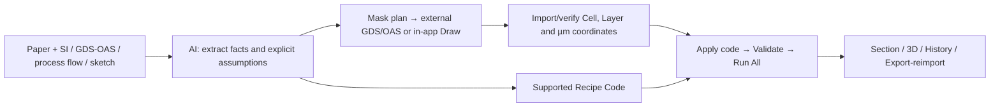
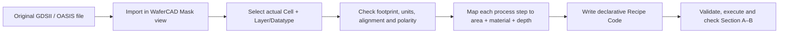
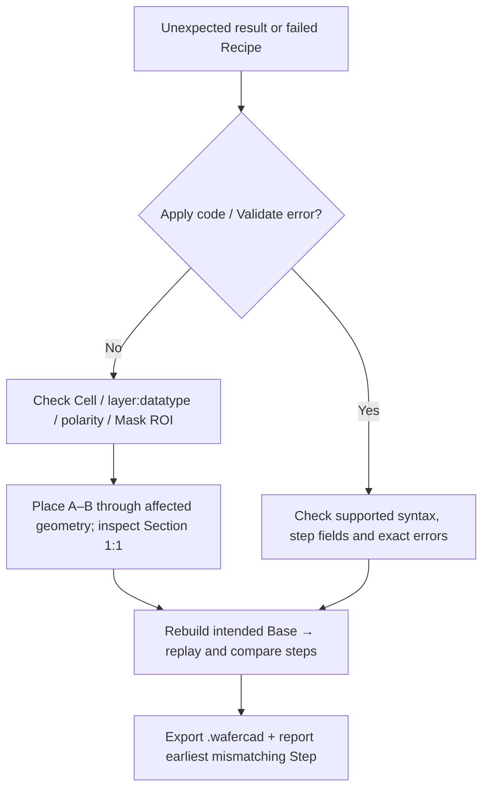

# Using WaferCAD with AI

> Developing the WaferCAD source with AI? See [Develop WaferCAD with AI](Develop-WaferCAD-with-AI) for acceptance contracts, Kernel/App ownership, browser bypass limits and common traps.: A Practical Guide

[Home](Home) · [Getting Started](Getting-Started) · [Masks and ROI](Masks-and-ROI) · [Recipe Code Tutorial](Recipe-Code-Tutorial)

Use an AI assistant to turn a research paper, a process description, a mask layout, or an early device idea into a **testable WaferCAD geometry project**. This chapter is task-oriented: it tells you exactly what to provide, what to ask the assistant to produce, how to run the result, and how to check it.

**Start here:** [Open WaferCAD](https://xiaolong-6.github.io/WaferCAD/). WaferCAD has a restricted, declarative Recipe language; it does **not** run arbitrary JavaScript or Python in its Recipe Code editor. An AI assistant can draft Recipe text and, with an external coding environment, create a GDSII/OASIS mask for import. Do not assume the assistant can directly inspect your browser tab, operate WaferCAD, or manufacture a device.

## 1. Choose your starting point



_This is a human-reviewed file handoff, **not** an automatic connection between an AI service and the WaferCAD browser. Geometry and acceptance are checked in WaferCAD after import._

| I have...                    | Attach to the AI conversation                                                         | Ask for...                                                          | Deliverable to open in WaferCAD               |
| ---------------------------- | ------------------------------------------------------------------------------------- | ------------------------------------------------------------------- | --------------------------------------------- |
| A published device           | Article PDF, relevant figures, supplementary information (SI) and Methods             | Source-derived geometry, mask specification, process sequence, code | GDSII/OASIS mask plus Recipe                  |
| An existing mask and process | GDSII/OASIS (or a text-exported layout manifest), step table, substrate specification | Mask-to-step mapping and Recipe code                                | Original imported mask plus Recipe            |
| Only a device concept        | Dimensioned sketch, intended materials, device footprint and fabrication constraints  | Annotated assumptions, geometric layout and feasible sequence       | AI-generated external GDSII/OASIS plus Recipe |
| A failing project            | Recipe code, exact error, exported `.wafercad` file if available, and screenshots     | Minimal repair preserving existing geometry and intent              | Corrected Recipe and a reproducible check     |

**Attach the actual source files whenever possible.** Screenshots alone cannot reliably convey GDS hierarchy, datatype, original database units, or complete process parameters. If an AI tool cannot read binary GDS/OASIS files, give it a trustworthy exported cell/layer/coordinate manifest or use a coding environment capable of parsing the originals. Never have the assistant guess that an uninspected binary mask contains a particular cell or layer.

### Minimum project facts

Provide these details before generating executable code:

- **Starting Base:** footprint (rectangle/circle), width/height or diameter, thickness, face orientation and existing stack. The Recipe does not create a Base.
- **Units and coordinates:** use explicit nm, µm or mm; specify the mask-to-substrate position, scale and rotation. WaferCAD stores canonical physical dimensions in µm.
- **Mask mapping:** file source or Draw source; actual Cell name; layer/datatype pairs such as `3|0`; which patterns are openings versus protected material.
- **Process intent:** ordered operations, material names, thickness/depth, front/back face (or a supported Recipe `face: 'both'` operation), and **Whole face / Selected mask / Invert mask** for each step. Do not use Both for Lift-off or Planarize/CMP.
- **Evidence versus inference:** article section or figure for each claimed parameter, with unknowns clearly labeled _assumption_ or _illustrative_.

**Important ROI distinction:** Mask ROI limits Process operations, even Whole face, and limits mask exports. Main/3D ROI only clips inspection and applicable 3D exports. Clear an unintended Mask ROI before a truly full-face step.

## 2. Workflow A — Research paper to a process model

**Example task:** reconstruct a patterned oxide/contact-window structure described in a semiconductor paper. The numerical values below are **illustrative**, not sourced process parameters from a particular publication.

For a real paper-derived WaferCAD reconstruction, see the [photodetector example and its scientific assumptions](Examples-and-Modeling-Limits). Its saved example thumbnail depicts a **different structure** from this oxide-window exercise, so it is intentionally not reused here.

**Upload:** (1) the paper PDF, (2) relevant SI/Methods, (3) screenshots of the cross-section and top-view layout, and (4) an existing GDS/OAS file if the authors provide one. If no layout exists, include a dimensioned sketch or approximate dimensions and ask for an explicitly illustrative mask.

**Copy this prompt into your AI tool:**

```text
Act as a semiconductor process integration engineer and WaferCAD Recipe author.

I am attaching a research paper, supporting information, and device figures.
Reconstruct the device as an idealized WaferCAD geometric process model.

1. Extract a material-stack table with thickness, dimensions, and each source
   (paper page/figure, SI section, or "assumption"). Do not invent references.
2. Separate reported fabrication steps from a geometrically equivalent
   WaferCAD approximation. Mark unsupported physical effects explicitly.
3. Propose a Base footprint and a mask plan: purpose, cell, GDS layer/datatype,
   aperture/polarity, shape geometry in µm, origin, and alignment.
4. Produce a numbered process-flow table with face, area, material, operation,
   parameters, mask reference, and expected cross-section after each step.
5. Generate WaferCAD Recipe v1 code using ONLY the documented commands:
   deposit, extend, etch, liftoff, implant, electrical, record, snapshot.
   Use literal objects and explicit units; no variables, loops, or custom API.
6. If a new mask is necessary, provide an independent GDSII/OASIS generation
   script for an external environment. Do NOT place that script in Recipe Code.
7. List ambiguous dimensions or unsupported operations for my decision.
8. Give acceptance checks for mask import, Validate, Run All, Section A-B,
   History, project export/reimport, and independent mask export.

Do not claim that geometric output predicts real etch rates, ALD kinetics,
doping distributions, or device performance. Prefer a small, testable
single-device model before suggesting a full-wafer array.
```

**Review before running:** verify the extraction table against the paper yourself. In particular, figure scale bars, mask polarity, lateral offsets and unreported process parameters must not silently become "paper-derived" facts. Where necessary, ask the AI to propose two labeled interpretations rather than invent one definitive geometry.

**Bring the result into WaferCAD:** establish the Base in Project/Base; import the generated or original GDS/OAS into Mask; inspect its Cell, layer/datatype and position; then open **Process → Code** (beside Recipe in the current workstation), paste the Recipe, click **Apply code**, and **Validate**. For a clean run select **Start → Rebuild Base first (new Main)**, review the History/Variant confirmation, and use **Run All**. Inspect the Section at each major step and make sure the A–B line crosses the intended feature.

### A minimal reference Recipe

Use this when you want to verify the Code editor before attempting a literature reconstruction. **Prerequisite:** a Base exists. The 200 nm oxide and 30 nm conformal film are example inputs, not experimentally validated process settings.

```javascript
snapshot('00 - Starting Base');
deposit({
  material: 'SiO2',
  thickness: '200 nm',
  coverage: 'directional',
  face: 'front',
  area: 'full',
});
snapshot('01 - Oxide deposited');
deposit({
  material: 'Al2O3',
  thickness: '30 nm',
  coverage: 'conformal',
  face: 'front',
  area: 'full',
});
record({
  process: 'anneal',
  label: 'Post-deposition anneal (record only)',
  temperatureC: 350,
  durationMin: 30,
  ambient: 'N2',
});
snapshot('02 - Passivated');
```


_Conceptual **conformal** coverage on exposed horizontal/sidewall faces; the Recipe's specific flat Base does not necessarily expose sidewalls. The diagram is not a screenshot of the result above._

The `record()` statement adds a History entry; it does not calculate an annealing reaction. For mask-conditioned etching, continue with the [complete code tutorial](Recipe-Code-Tutorial).

## 3. Workflow B — Existing mask and process flow to Recipe code



_This is a verification workflow, not an image of your imported mask. A blurred legacy UI thumbnail was removed because its text and geometry were unreadable._

**Upload:** original `.gds`/`.gdsii` or `.oas`/`.oasis`, the step-by-step process flow (PDF, spreadsheet or plain text), Base size/thickness/material, and a layer map. Helpful extras include a top-view screenshot, cross-section and intended mask alignment.

**Provide a layer map in this form (replace these sample values with the actual file contents):**

| Actual Cell | Layer/Datatype | Meaning in the process | Tone / area           | Units                       |
| ----------- | -------------- | ---------------------- | --------------------- | --------------------------- |
| `TOP`       | `3             | 0`                     | Oxide contact windows | Etch **inside** polygons    | µm  |
| `TOP`       | `7             | 0`                     | Contact metal pattern | Process **inside** polygons | µm  |

**Prompt:**

```text
Convert the attached mask and numbered process-flow document to a WaferCAD
Recipe. My Base dimensions, orientation and existing materials are supplied.

Read the actual GDS/OAS hierarchy and database units if your environment
supports it. Otherwise STOP and ask for a verified cell/layer/coordinate
manifest; do not pretend you decoded the file.

First output a mask inventory and an explicit mapping of every process step
to cell, layer/datatype, mask polarity, face, and physical dimensions.
Preserve the original order of the flow and identify any missing information.

Then generate a single complete WaferCAD Recipe v1 script using only
documented commands and literal arguments. Use area: 'mask' or 'invert'
with a valid captured/imported File Mask context. Do not create fictional
layers, Cells, functions, loops, or mask primitives in Recipe Code.

Output:
A. Input assumptions and unresolved questions.
B. Verified mask-to-step mapping.
C. Numbered process-flow table.
D. Complete copy-ready Recipe code.
E. Stepwise validation and expected Section/3D results.
F. A troubleshooting table for missing layers, materials, polarity or units.
```

For a **File Mask**, this pattern refers to Cell `TOP`, GDS layer 3 and datatype 0 **only if those are present in your imported mask**:

```javascript
deposit({
  material: 'SiO2',
  thickness: '200 nm',
  coverage: 'directional',
  face: 'front',
  area: 'full',
});
etch({
  target: 'SiO2',
  depth: '200 nm',
  profile: 'directional',
  face: 'front',
  area: 'mask',
  mask: { source: 'file', cell: 'TOP', layers: ['3|0'] },
});
snapshot('Oxide window opened');
```

To use a **Draw Mask**, create shapes in the Mask view and use **Use current Mask** on the corresponding Recipe Step; WaferCAD captures the real Draw shapes and transforms into that step. `mask: { source: 'draw' }` without shapes is incomplete. A captured mask remains attached to its step when the current selection later changes.

## 4. Workflow C — Device idea to mask and process

Start with a dimensioned sketch: for example, four different TiO₂ meta-atom geometries on a substrate. The AI should return a **parameter/assumption table**, not claim that the dimensions are an optical design optimization.


_The **actual example's illustrative schematic** contains four geometry families; it is neither the authors' optimized GDS nor a computed optical phase map. See the [metalens example and its assumptions](Examples-and-Modeling-Limits)._

**Upload:** sketch or diagram, substrate footprint, target dimensions and material stack, desired number of cells/features, allowed mask layers, and any process constraints. If an actual publication is the inspiration, include it and distinguish its reported parameters from your proposed design.

**Prompt:**

```text
I have a device concept but no layout file. Help me make a reproducible
illustrative WaferCAD model.

Define the Base, coordinate origin, four explicitly dimensioned example
features, mask polarity, material stack and process-flow sequence.
Separate fabrication assumptions from directly specified design facts.

Produce:
1. A mask geometry table (cell, GDS layer/datatype, x/y, shape, dimensions).
2. An external Python layout-generation script using a clearly identified
   library and version, writing a GDSII file; include instructions to run it.
3. WaferCAD Recipe v1 code for the ordered process after mask import.
4. A file-by-file handoff list and steps to validate the GDS in Mask view.
5. Expected Section views and a list of unsupported physical predictions.

Do not use Python syntax in the WaferCAD Recipe editor. Do not invent a
built-in mask-generation command, or describe illustrative dimensions as
measured or publication-supplied optimization results.
```

Generate and inspect the external GDS first. For repeated full-wafer designs, validate a single unit or bounded ROI before attempting a large array; a saved History alone is not evidence of a successful full-array Recipe replay. See [Examples and Modeling Limits](Examples-and-Modeling-Limits).

## 5. Debug a failed or incorrect Recipe with AI

**Upload:** the exact Code text, complete error message, the original mask or trustworthy cell/layer manifest, project `.wafercad` if accessible to the assistant, and screenshots of Mask, Section A–B and History. State **which step** first differs from expectation. Remove any confidential or unpublished data you cannot share with the chosen AI service.

**Prompt:**

```text
Debug this WaferCAD project without changing the intended device design.

Expected result: [describe target cross-section and mask footprint].
Actual result: [error text or unexpected structure].
First failing Step: [number / name].
Files: [Recipe, .wafercad, GDS/OAS or layer map, screenshots].

Check, in order:
1. Recipe v1 syntax and supported command parameters.
2. Base and existing material dependencies, actual exposed surfaces.
3. Imported Cell and layer/datatype, mask source, polarity and alignment.
4. Mask ROI versus Main/3D ROI; selected/inverted/full-face semantics.
5. Physical units, face (front/back), step order and absolute CMP targetZ.
6. Whether the error is a parser failure, preflight error, worker failure,
   geometry mismatch, or only a camera/Section A-B visibility issue.

Return a root-cause hypothesis with cited input evidence, a minimal corrected
Recipe (or precise UI correction), and a test that would have caught it.
Do not hide errors by changing the visual baseline, deleting History,
or replacing known dimensions with guessed values.
```



_Use this order to isolate the failure; the diagram does not imply that every unexpected render is a parser defect._

**Common failure checks:** `Validate` confirms syntax and some dependencies but is not geometric certification. An incorrect A–B line can miss a correctly etched opening. Running a Recipe using **Continue current model** can deposit the same material twice. `Stop` retains steps already committed. A true clean-replay check uses the intended Base plus imported Masks.

## 6. Review, compare, and hand off

After the first successful run, ask AI to propose controlled variants (for example a film thickness change) and list exactly which inputs change. Preserve the baseline as a separate exported `.wafercad` project or explicitly named Variant; do not overwrite a validated baseline with an unverified candidate.

Before declaring a result complete, check:

- [ ] The process-flow table agrees with the source; every inferred value is labeled.
- [ ] Base units, physical thickness and mask coordinates are verified.
- [ ] Correct File/Draw source, Cell, layer/datatype, polarity and Mask ROI.
- [ ] Code **Apply code → Validate → Rebuild Base first → Run All** succeeds.
- [ ] Section A–B crosses representative features; material owners and cavities are correct.
- [ ] Main/3D/History/Snapshots show the intended sequence without unexpected duplicates.
- [ ] A portable `.wafercad` export re-imports; Mask export is checked separately.
- [ ] Any scientific conclusions respect the geometric model's limitations.

**Modeling boundary:** WaferCAD produces idealized material geometry and structural annotations. It does not calculate etch chemistry or rates, conformal growth kinetics, dose/activation/diffusion, electrostatics, optical response, or fabrication yield. Surface Rough/Pyramid representations can be display-only. An AI-generated plausible cross-section is **not** evidence that a real process will produce it.

**Further reading:** [Recipe Code Tutorial](Recipe-Code-Tutorial) · [Process Operations](Process-Operations) · [Import and Export](Import-and-Export) · [Troubleshooting](Troubleshooting).
