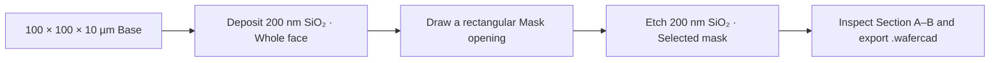

# First 10 Minutes: Your First Masked Structure

[Home](Home) · [Getting Started](Getting-Started) · [Troubleshooting](Troubleshooting)

**New to semiconductor processing? Start here.** This walkthrough does not require a GDS file, a Recipe, or knowledge of photolithography. You will make a rectangular substrate, add an oxide film, open a window in it, and export the result.

> **Before editing:** Use a **new blank project**. The steps below modify its geometry. If you opened an existing research example, use [Export](Import-and-Export) to keep your own copy before experimenting. All dimensions here are **teaching values**, not manufacturing recommendations.

## What you will make

1. A **100 × 100 µm** rectangular **Base**, **10 µm** thick. We treat this generic substrate as silicon for the exercise; the application initially names its layer **Base**.
2. A **0.2 µm (200 nm) SiO₂** film across the front face.
3. One rectangular opening in that film, made with an on-screen Draw mask.

_This is the exact sequence used in the exercise. The Mask selects the etch footprint; it is not an additional material layer._

_This diagram illustrates the operation, not your project's exact dimensions._

## Step 1 — Build a substrate

1. Open [WaferCAD](https://xiaolong-6.github.io/WaferCAD/) and click **Start empty** on the Welcome screen. If you are already in the workspace, use **Project → New** and review any confirmation before discarding work.
2. Open **Project** and choose **XYZ display unit → µm**. This controls the units of Base and manual Process inputs, without changing stored geometry.
3. In the **Base** editor within Project, choose **Shape → Rectangle**; set **Width = 100**, **Height = 100**, and **Thickness = 10** (µm).
4. Click **Rebuild Base**. If a confirmation appears, read its History implications before continuing. Choose **Main** or **Overview** to inspect the rectangle on desktop, or switch to **View** using the bottom navigation on a compact screen. Use **Fit** if it is off-screen.

**Check:** Main should show one rectangular substrate without patterned openings; Section A–B should show a single **Base** body from Z = −5 µm to +5 µm. **Base** is the default layer name, not a physical silicon material specification. If an older project's History is still present, use **Project → New** rather than continuing in that project.

## Step 2 — Coat the entire front face

1. Open **Process → Manual** and choose **Surface → Front**.
2. Choose **Operation → Deposit**, **Area → Whole face**, and **Coverage → Direct** (directional deposition).
3. Set **Layer name = SiO2** and **Thickness / depth = 0.2** with display units set to µm (equivalent to 200 nm). This layer name labels geometric material; it does not activate a chemical simulation model.
4. Set **Also add to Recipe → No**; then click **Apply** **once**.

**Check:** **Section A–B** should show a thin oxide layer over the Base. The process History should have advanced. Section **Auto** can exaggerate Z; switch to **1:1** to compare physical scales, although a 0.2 µm film may then be difficult to see.

**If nothing happens:** Check **Front**, **Whole face**, the selected operation and the Z input. Look for an on-screen warning before clicking Apply again; repeating Deposit can add a second film.

## Step 3 — Draw a mask without importing any file

1. Open the **Mask** view. Use the **Mask source** control to switch from **File** to **Draw**; do not assume the previously saved source mode.
2. Select the **Rect** drawing tool, then drag a rectangle **inside the substrate outline**, preferably near the center and leaving plenty of margin. Drawing is a one-shot action; the tool returns to Select afterward.
3. If needed, use **Fit** to bring the wafer into view. Leave the **Mask ROI** control empty/cleared for this tutorial. Do not create a 3D ROI (Main view) either; it is unrelated to processing.

**Check:** You should see a rectangle in Draw mode, over the wafer reference. The current **Draw** mask can be used for Process even without a GDS/OAS file.

**Important:** The rectangle represents the **area where the next mask-based operation takes effect**. **Selected mask** means inside that rectangle; **Invert mask** means outside it. A **3D ROI (Main view)** only clips 3D inspection and will not limit etching.

## Step 4 — Open a window in the oxide

1. Return to **Process → Manual**. Keep **Surface → Front** selected.
2. Choose **Operation → Etch**, **Profile → Directional**, **Area → Selected mask**.
3. In the Etch **Material** selector, choose the oxide layer **SiO2** rather than **All exposed materials**.
4. Keep **Surface → Smooth** if shown, confirm **Also add to Recipe → No**, set **Thickness / depth = 0.2** at µm display units, then click **Apply** once.

_This schematic illustrates a selective oxide opening; check your **own** rectangular Draw Mask and A–B slice for the actual result._

**Check:** The oxide should be removed **within the drawn rectangle**, leaving oxide around it and the original **Base** layer below. In **Section A–B**, place the A–B line so it **passes through the opening**; a section line that misses the opening will look unchanged. The **3D** view can help locate the opening, but Section is the better check of layer ownership and actual depth.

**If the whole film disappears:** Confirm **Area = Selected mask**, the active Mask source says **Draw**, the rectangle is inside the substrate, and no Mask ROI is unexpectedly active. **Undo** a wrong operation, correct the input, and apply once. If silicon was removed, check that you selected **SiO2** as the Etch Material rather than **All exposed materials**.

## Step 5 — Keep a portable result

Open **Project** and use **Save** if you want a checkpoint in this browser's **Recovery** list. Then use **Export** to download a **`.wafercad`** project; keep that file because browser storage is not a permanent backup. You can also open **Mask → More → Export** to download the selected mask geometry in SVG/GDS/OAS format.

**Done when:** You can identify the silicon base, the oxide film, the one patterned window, and the successive states in **History**, and you have downloaded a `.wafercad` file.

## Five terms you need right now

| Term               | Plain meaning                                                                                          |
| ------------------ | ------------------------------------------------------------------------------------------------------ |
| **Base**           | The starting geometric substrate. Its default label does not assert a chemical material.               |
| **Mask**           | A 2D shape saying **where** an operation acts; a Draw mask needs no imported file.                     |
| **Process / Step** | One change to the geometry, such as Deposit or Etch.                                                   |
| **Section A–B**    | A cut through the structure **along the A–B line**, showing which material is above or below another.  |
| **History**        | Previous saved states of the structure. **Recipe** is an ordered list of operations you can run again. |

## Where next?

Try the [Workspace and Views](Workspace-and-Views) chapter to learn navigation, then [Masks and ROI](Masks-and-ROI) to understand selected/inverted regions. Use [Process and Recipes](Process-and-Recipes) when you are ready to automate the sequence. For ready-made research structures, see the [nine Welcome examples](Examples-and-Modeling-Limits) and their modeling limits. If an operation gives an unexpected result, consult [Troubleshooting](Troubleshooting).

**Scope:** WaferCAD demonstrates mask-conditioned geometry. It does not calculate actual etch rates, deposition kinetics, dopant physics, or device electrical performance.
