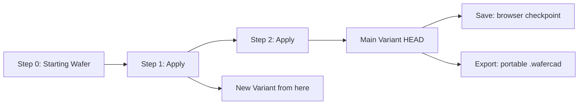

# History, Variants and Recovery

[Home](Home) · [Process and Recipes](Process-and-Recipes) · [Import and Export](Import-and-Export) · [Troubleshooting](Troubleshooting)

History is a **process timeline and branching graph**; Recovery and
Export are different ways to protect saved projects. Use the correct
mechanism before editing an old Step or replacing the Base.

## History and snapshots

### From Step 0 to a finished process

**Step 0 · Starting Wafer** is the editable starting substrate.
Select its row to inspect the initial condition or edit the Base;
subsequent Process Steps are separate physical operations. Use
**Project → Base → Rebuild Base** to change the initial substrate
while managing existing History. When existing Steps/Variants
would be affected, choose deliberately between **Keep previous
history** (preserve the older Main as a restorable Variant),
**Clear history** (replace its lineage) and **Cancel**. Clear
is **not** an archive or automatic backup.

Each successful **Apply** records a new physical Step with
validated material state. A **Record** Step documents chronology
without changing solids. Aborted, failed, busy and no-change
operations do not add a physical Step. An optional **bookmark**
names a Step or a saved inspection state; a bookmark is not another
material processing operation.

## Variants

A Variant is a branch of the process lineage, not a second bookmark.
Its saved HEAD can contain its own later Steps and child Variants;
restoring the parent must not delete that child history.

## Inspect versus change a historical Step

Click a restorable Step to inspect its exact saved material
state. The active Variant still owns its previous **HEAD**.
The Historical state indicator offers a route back to HEAD.
Clean browsing alone must not generate extra Recovery checkpoints.
Camera, pan/zoom, Section A–B, display and ROI are inspection
state, not separate fabrication Steps; moving around the views
must not silently replay a deposition.

Applying a new operation while inspecting a historical Step
creates a new continuation **Variant**, protecting the previous
HEAD. Do not assume Apply overwrites the old branch or that
navigating backward physically undoes saved later Steps.
The History panel and the shell Undo/Redo follow the same
underlying process transaction state.

## Edit an existing operation

1. In the History Step menu choose **Edit Step…** for a Step
   with stored replay metadata. The editor restores that
   Step's original Mask/ROI input and its **predecessor geometry**
   and opens the Process form with its saved parameters.
2. Adjust the parameters, then choose **Save edited Step**.
   WaferCAD now presents the supported tail handling modes:
   **Replace & discard later Steps**, **Replace & replay later Steps**
   if all required Steps are replayable, or a **new Variant**.
3. If child Variants depend on the original tail, use the
   offered copy-on-write Variant path rather than silently
   destroying their source history. Automatic replay stops on
   its first failing/no-change step; unsupported legacy replay
   metadata cannot be guessed.

A Recovery checkpoint is required **before** a destructive
History edit. If checkpoint creation fails, the edit must
not proceed. Older imported Steps lacking replay descriptors
can still be inspected or branched from when restorable,
but **Edit Step** and automatic replay may be unavailable.

## Insert before, continue or branch

**Insert before…** restores the selected Step's predecessor
and original saved input context, then inserts a new Process
operation. Choose **Update current Variant** to recompute its
later replayable tail; **New Variant · Carry later Steps**
to preserve the original and replay a child tail; or
**New Variant · Start from here** to keep the inserted Step
without carrying the old tail. Dependent branches and missing
replay metadata can restrict the available modes. An inserted
material Step may require remapping downstream layer IDs;
this is part of replay validation, not something to fix by
renaming a visible Layer row.

**Continue from here…** keeps the selected Step, truncates
**later Steps on the same Variant**, and makes that Step HEAD.
**New Variant from here** preserves the original path and
creates a child rooted at the selected Step. **Delete last
Step** is available only where a restorable predecessor
can be recovered and child dependencies remain protected.
Review the affected tail in the in-app confirmation before
committing; these commands differ substantially.

A Variant is not a bookmark. It has its own ancestry and
HEAD, and may have child Variants anchored to intermediate
Steps. Rename a Variant using its name or edit control.
Layer/Implant/Electrical Region renaming must preserve the
stable entity IDs used by History and replay, rather than
making an independent, conflicting view-only label.

## Save, Recovery and Export

| Action | What it protects | Important limitation |
| --- | --- | --- |
| **Save** | Current project in browser storage and an explicit local Recovery checkpoint | Not a portable file or an off-device backup |
| **Recovery** | Lists, restores or clears local checkpoints in the Project tab | Restore changes the current workspace; clear deletes stored checkpoints |
| **Export** | Downloads an independent portable `.wafercad` project with saved History/Variants | Keep the file in a safe location for archival research |
| **Open/Import** | Loads a portable project after schema/geometry validation | May replace the active project; confirm first |

Save and automatic browser persistence are not the same
as exporting a file. Clearing site data, changing profiles
or losing the device can destroy browser-local Recovery.
For research records and before risky edits, **Export** an
independent project.

## Multi-tab editing

### Writer ownership and failure recovery

Only the active writer should save the shared workspace.
Another tab may be in read-only or takeover state and show
a conflict warning. Finish or export any unique work before
accepting a takeover. If a tab loses its writer lease during
an asynchronous Save, **that stale tab must not commit** a
replacement workspace. Refreshing should normally restore
the latest safely persisted state, but a stale in-memory
view is not proof that its edits were saved.

A failed Worker operation, failed Save or rejected History
replay must leave the last committed geometry and lineage
intact. If anything seems missing, stop applying Process
operations, inspect available Recovery points, and export
the current project before experimenting with restoration.
Two concurrently open tabs are not a merge/conflict-resolution
system; export separate copies if both contain useful work.

## Recipe and geometry replays

A Recipe runs actual geometry operations; running it twice
is **not** necessarily idempotent. Compare a new process
from the correct Base/Step, or use an explicitly selected
Rebuild Base or Variant path. The experimental
**Continuous release** can own one exact etch in a lineage;
unsupported follow-on physical Process operations fail
closed rather than flattening the analytic undercut into a
banded approximation. See [Process Operations](Process-Operations)
and [Troubleshooting](Troubleshooting).
