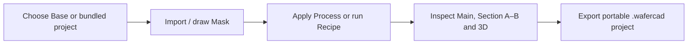

# WaferCAD · Product User Manual

**WaferCAD** is a browser-based visual editor for **building and inspecting layered semiconductor structures**. You can start with a silicon wafer, draw or import a mask, and apply Deposit, Etch and other operations. **No installation is required.**

[**Open WaferCAD**](https://xiaolong-6.github.io/WaferCAD/) · [**Try the 10-minute tutorial**](First-10-Minutes) · [Browse example devices](Examples-and-Modeling-Limits)

_This is the user journey, not a capture of the live interface. Actual device preview thumbnails are shown with the named projects in [Examples and Modeling Limits](Examples-and-Modeling-Limits)._

## Current desktop Workstation

_Real Chromium capture of the **empty project** in WaferCAD's desktop Overview; all four views and the Project/Base controls are visible. Source [main@90fb16836eec](https://github.com/Xiaolong-6/WaferCAD/commit/90fb16836eecca3ebcfdf734b15150232d081c74), 1440 × 960. This is a starting-wafer orientation image, **not** the completed oxide-window exercise or a research-device result._

## Choose your path

**I want to try the app without coding.** [Open an existing example](Examples-and-Modeling-Limits) and click a project's title or description on the Welcome screen.

**I'm completely new.** Follow [First 10 Minutes](First-10-Minutes) to draw a rectangle and selectively etch a 200 nm oxide. The beginner tutorial uses **Start empty**, explains the Project/Base controls and shows how to check each result.

**I want to understand the interface.** Read [Getting Started](Getting-Started), then [Workspace and Views](Workspace-and-Views).

**I have a GDSII/OASIS mask.** Read [Masks and ROI](Masks-and-ROI), then [Import and Export](Import-and-Export).

**I want AI to help reproduce a paper or generate a Recipe.** Follow [Using WaferCAD with AI](AI-Assisted-Workflows) for prompts, required attachments, Mask and Recipe handoff, and validation.

**I am developing WaferCAD with AI.** Start with [Develop WaferCAD with AI](Develop-WaferCAD-with-AI) for evidence-first workflows, App versus Kernel diagnostics, local Chromium screenshots and release gates.

**I want to build a process sequence.** Read [Process and Recipes](Process-and-Recipes); then the [Recipe Code Tutorial](Recipe-Code-Tutorial).

**An operation gave me the wrong geometry.** Start with [Troubleshooting](Troubleshooting). For all 20 before/after operation diagrams, use [Illustrated Process Operations](Process-Operations).

## Three things to understand

1. **Mask** decides **where** a patterned operation acts. **Mask ROI** limits processing; **Main ROI** clips the 3D view only.
2. **Section A–B** shows a slice _along the A–B line_. If the line misses an opening, the section will miss it too. The 3D view helps orientation.
3. **Save** makes a **browser Recovery checkpoint**; **Export** downloads a portable `.wafercad` file. Export is the safer way to keep a project outside this browser.

WaferCAD calculates **idealized geometric material stacks**, not physically calibrated manufacturing outcomes. Surface roughness/pyramids can be display-only; implant and electrical regions are annotations. For research interpretation, read the [example provenance and modeling limits](Examples-and-Modeling-Limits).

## Complete reference

- [Masks and ROI](Masks-and-ROI) — File/Draw sources, mask selection and clipping.
- [Process and Recipes](Process-and-Recipes) — individual operations, guided recipes and execution safety.
- [History, Variants and Recovery](History-Variants-and-Recovery) — previous states, alternate branches and browser checkpoints.
- [Import and Export](Import-and-Export) — project, mask and 3D interchange.
- [Examples and Modeling Limits](Examples-and-Modeling-Limits) — the published Welcome examples and scientific caveats.
- [Using WaferCAD with AI](AI-Assisted-Workflows) — practical paper-to-mask and mask-to-Recipe prompts, inputs, outputs and validation.
- [Process Recipe Code Tutorial](Recipe-Code-Tutorial) — eight supported commands, mask capture and replay.

## For contributors and documentation maintainers

If you are **changing WaferCAD's source code**, use [Develop WaferCAD with AI](Develop-WaferCAD-with-AI) for scientific provenance, component ownership and source-specific acceptance (T-CMOS #225 is an example, not a generic device requirement). Product users should instead follow [Using WaferCAD with AI](AI-Assisted-Workflows) for editing Masks and Recipes.

This wiki is generated from reviewed Markdown under `docs/wiki/` on the repository's `main` branch. Each main push checks and synchronizes managed pages. The [Process Operations](Process-Operations) illustrations share their source with the in-app Process guide. For authoring and publication rules, read the [Wiki sync contract](https://github.com/Xiaolong-6/WaferCAD/blob/main/docs/WIKI_SYNC.md) and [source documentation](https://github.com/Xiaolong-6/WaferCAD/tree/main/docs).

> All before/after illustrations are conceptual. They are not predictions from fabrication parameters or the currently open project.
