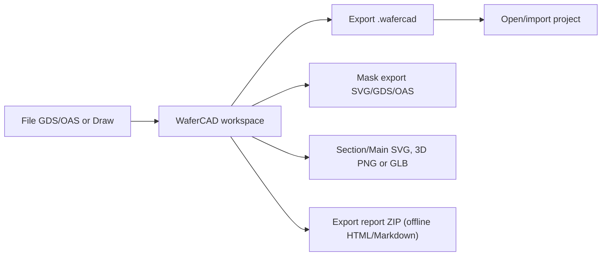

# Import and Export

[Home](Home) · [Examples and Modeling Limits](Examples-and-Modeling-Limits)

## Project format

_The portable project includes more than the exported mask or a single rendered view._

WaferCAD exports portable `.wafercad` JSON projects, including vector material stacks, layers, masks, process history, variants, annotations, view settings, and Recipe. The current project schema is v14, with optional typed Recipe metadata. Compact files use a 0.1 nm grid; Export automatically falls back to lossless encoding when compact storage would alter physical Z/depth/profile lengths in current or restorable History states, or invalidate geometry. Autosave and Recovery remain lossless. Project schema is versioned and old formats are migrated only when supported; invalid files are rejected rather than silently loaded.

## Mask import

Open GDSII or OASIS with hierarchical Cells and Layer/Datatype selections. File source and Draw source remain separate. Imported coordinates are physical; a mask does not automatically fit the substrate.

## Mask export

Export SVG, GDSII or OASIS from the active Mask view. Select export scope as appropriate; **Mask ROI** restricts the geometry exported. When editing Draw shapes, verify the chosen source before exporting.

## View and geometry export

- **Main/Section** provide schematic SVG exports.
- **3D PNG** captures the currently visible 3D view at 3× resolution, including its active opacity, vertical display scale, origin visibility, border and current roughness LOD. It is a presentation capture, not a physical geometry export; the GLB geometry contract is unchanged.
- **GLB** exports the visible physical inspection geometry and respects an active Main ROI.
- GLB can embed deterministic rough/pyramid relief. Export mesh quality is constrained by a triangle budget and is not a TCAD mesh.

## Read-only Process Report export

The native v2 Project panel also offers **Export report (ZIP)**. This creates a
portable offline HTML report with editable Markdown, paginated Process History
(up to 50 steps per page), exact operation descriptors, saved Recipe, Variants,
Bookmarks, and independent PNG captures of currently visible views. The
compact keyframe policy additionally attempts up to **24 genuine saved-state
Section SVG figures** in an isolated Worker, with explicit per-node failures and
omissions. It does not infer missing historical states or images. Hidden current
views are omitted with explicit warnings.

The report is read-only: the historical Section SVGs are inspection figures,
not restorable or editable project geometry. **Export a separate `.wafercad`**
to preserve the engineering backup. See [Process Report Export](https://github.com/Xiaolong-6/WaferCAD/blob/main/docs/io/REPORT_EXPORT.md)
and [Report Keyframes](https://github.com/Xiaolong-6/WaferCAD/blob/main/docs/io/REPORT_KEYFRAMES.md) for provenance, export limits,
and acceptance coverage.

## Persistence safety

Save and Open validate project content, including size and geometry. The local Recovery cache is convenient for continuing browser work but cannot replace a downloaded project backup.

## Version compatibility

Some storage optimizations, especially canonical translation arrays, need newer readers. If an older build rejects a project, update the application; do not try to remove required array metadata manually.
