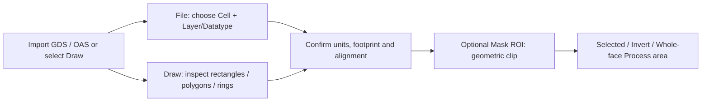
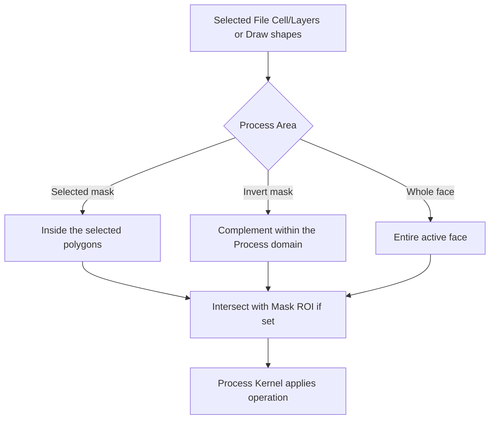
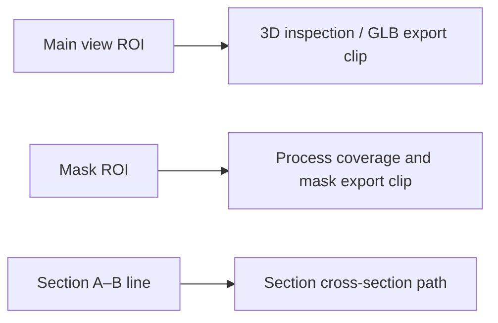

# Masks and ROI

[Home](Home) · [Process and Recipes](Process-and-Recipes)

## File masks

_This illustrates actual data selection and clipping, **not a screenshot**. Review the selected geometry in your current Mask view before processing._

Import GDSII (`.gds`, `.gdsii`) or OASIS (`.oas`, `.oasis`). Hierarchical **Cells** and global **Layers** are independent selections. The layout keeps its physical database units on import; alignment may change X/Y translation, scale and rotation. Zero-width linework is visible but not an operable area.

## Draw masks

The Draw source keeps independently editable Rectangle, Circle, Polygon, Ring, and Ring Sector objects. A double-click completes a Polygon, and existing shapes can be dragged or edited numerically. Switching File ↔ Draw does not replace the original file layout. Draw shapes combine by union for Process selection.

## Process Area

_This is the actual **selection logic**, independent of material thickness. Mask ROI clips every Area choice; it never modifies the source GDS/OAS polygons._

| Choice            | Affected area                                                          |
| ----------------- | ---------------------------------------------------------------------- |
| **Selected mask** | Selected File geometry or union of current Draw geometry.              |
| **Invert mask**   | Complement of the current mask within the Process domain.              |
| **Whole face**    | Active face without a mask pattern; an active Mask ROI still clips it. |

**Mask ROI** clips the final Process domain for **Selected mask**, **Invert mask**, and even **Whole face** when active, as well as SVG/GDSII/OASIS mask exports. Clear Mask ROI before using Whole face if you truly intend the entire substrate. It never rewrites the source layout. It is independent of the Main ROI and A–B line.

## 3D ROI (Main view)

_Three different controls, three different effects. A 3D ROI does not limit Etch or Deposit._

**3D ROI** in Main may be rectangular, circular or sector-shaped. It limits the 3D viewport and GLB export; it does **not** limit Apply. This is a frequent source of confusion: to restrict Process, use **Mask ROI**.

## Quick check: one rectangle, three different outcomes

For an easily verified comparison, begin with a **new blank project**
and a rectangular Draw Mask wholly inside the Base. Check the
selected geometry before applying anything:

1. **Mask ROI:** enable a smaller Mask ROI overlapping only part of
   the rectangle. Even **Whole face** Process operations are now
   restricted to this ROI. This changes Process selection, not
   physical material until an operation is applied.
2. **Main 3D ROI:** clear the Mask ROI, then set a Main ROI.
   The 3D inspection (and supported physical GLB clipping) now shows
   only the selected volume; the next Process operation is **not**
   limited by that 3D crop.
3. **Section A–B:** move the line through a feature and then away
   from it. Section changes because the sampled XY path changed;
   neither Mask selection nor previously committed material does.
4. **Before Apply:** clear both ROIs if the intended operation truly
   covers the entire face. Inspect the Process Area, current Mask
   source and active Front/Back face one last time.

The optional ROI editor permits geometric and numeric adjustment;
its canvas outline is a selection aid, not an etched wall. Never
infer a real Process cavity merely from a 3D ROI cut face.

## Troubleshooting selections

If a Process changes the wrong area, verify which mask source is active, which File cell/layers are selected, whether Invert is enabled, and whether Mask ROI is still active. **Whole face does not bypass an active Mask ROI** in the current Process implementation. Imported mask geometry is not automatically resized to the base.
