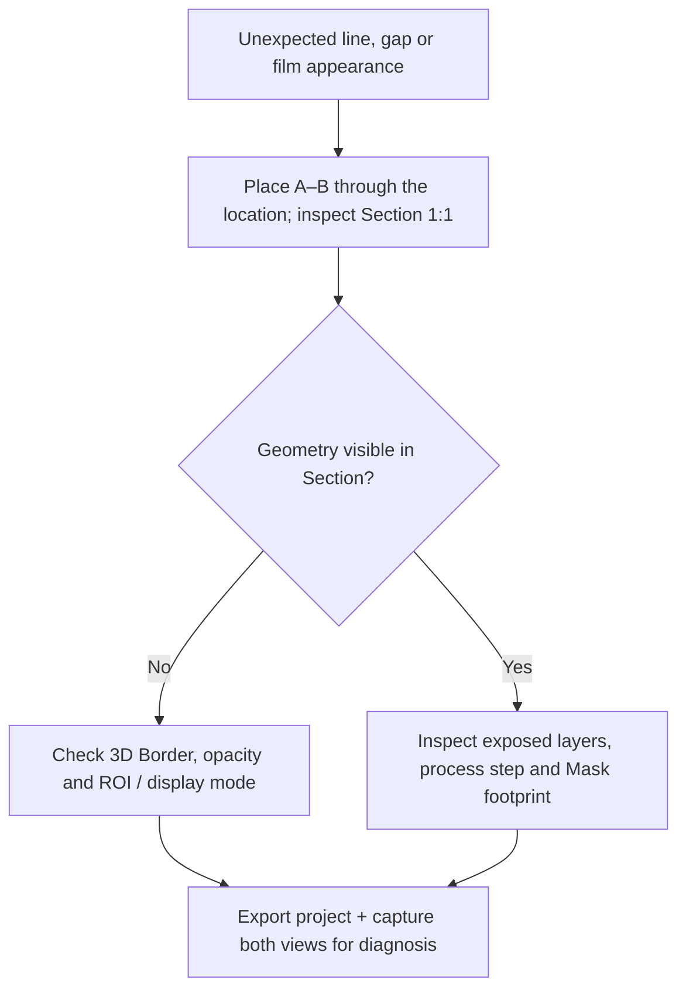

# Troubleshooting

[Home](Home) · [First 10 Minutes](First-10-Minutes) · [Getting Started](Getting-Started)

**Start with the observable symptom.** Check the **Section A–B** view and the currently selected **Mask**, **Front/Back** face, **Area** and **XYZ unit** before repeating an operation. Clicking **Apply** again may create another film or remove additional material.

## Apply changes nothing or the wrong location

Check the **Process Area** (Whole face / Selected mask / Invert mask), **Front/Back** side and the currently active **File/Draw** Mask. A hidden Mask ROI may reduce the process area **even if Area says Whole face**. Clear it to process the entire face. Correct the input or displayed error **before** repeating Apply.

## A mask exists, but Etch removed the entire film (or even the Base)

For a masked, selective etch choose **Area → Selected mask**, then choose the intended layer in Etch **Material** instead of **All exposed materials**. Check the etch depth and active Draw/File mask. Use **Undo** if available, then correct the inputs.

## The hole appears in Main or 3D, but not in Section

The **A–B line may miss the hole**. Move A/B in Main so that the line crosses the mask opening. A section through a different location can look unchanged even when the etch succeeded.

## Film thickness looks wrong

Check **Project → XYZ unit** and the number typed in Process Z. For example **0.2 µm = 200 nm**. The **Section Auto** view fits XY and Z independently and may visually exaggerate the height; **1:1** uses a common physical scale.

## A conformal coating has no sidewalls

_This is the in-app Process Guide's **Conformal Deposit** schematic. Check the actual Section and exposed sidewall in your own project._

Confirm **Coverage → Conformal**. Directional adds material on horizontal exposed surfaces; a conformal operation may coat actual exposed steps/sidewalls. Align A–B with the step to inspect it.

## I drew a rectangle, but it does not affect Process

In the Mask view header click **File** until the button says **Draw**. The rectangle must overlap the Base. In Process choose **Area → Selected mask**, not Whole face, and ensure **Mask ROI** is clear for the beginner exercise.

## An ROI changes the 3D view but not the etched area

You probably used **Main ROI**, which clips the 3D/GLB inspection view. To limit a mask-based Process, use **Mask ROI** instead. Both are independent of the Section A–B line.

## Run All duplicates layers

The Recipe may be set to **Continue current model**. For a clean reconstruction, export a backup and choose **Rebuild Base first (new Main)**, then carefully handle the History confirmation.

## My work is missing in another browser

**Save** keeps Recovery checkpoints in one browser profile. Use **Project → Export** for a portable `.wafercad` file, then import it elsewhere.

## Visual artifacts versus actual geometry

_This is a diagnostic checklist, not a proof that any specific artifact is display-only._

If you see an unexplained **black line**, toggle **3D Border** once to see whether the outline is merely visual. **That alone does not prove the geometry is correct.** Check a Section crossing the same XY location, and inspect the layer structure with different 3D opacity/ROI. A genuine thin sheet, seam or buried void that persists without Border deserves investigation; do not hide it by changing outline color or visibility. Save an exported project with the exact History step and the relevant Mask state when reporting it.

**Why can a conformal shell look wider in Section?** Section **Auto** may exaggerate Z; compare **1:1**. A real sidewall coating also has a physical XY normal offset equal to its thickness.

**Why does isotropic/undercut release remove material laterally beyond an opening?** Lateral removal is the point of these profiles. Use **Directional Etch** for a vertical-only footprint. Confirm the sacrificial target material.

**Why do rough or pyramidal surfaces differ between Section and 3D?** These are deterministic **display morphologies**, sampled at different visual resolutions; adaptive 3D detail does not change the canonical ideal material stack. For closer inspection, adjust **Fast/Quality** and the 3D ROI.

**Why does Record annealing not grow oxide, or an Implant not create actual dopant diffusion?** Record stores chronology only, and Implant/Electrical are geometric annotations. WaferCAD does not calculate chemical, electrical or thermal evolution.

**Why is an implant hidden in opaque 3D?** It is an internal annotation. An ROI cut may expose its colored cut face; lower opacity can show the buried annotation volume without removing material.

## Continuous release and historical replay failures

**Why does a second Process Step refuse a Continuous-release model?**
Continuous release owns a dedicated analytic material model with one
physical release per lineage. Follow-on Deposit/Etch or unsupported
array/rough/ROI combinations are not automatically converted to a
2.5D approximation. Inspect the selected target and physical seed,
then rebuild from a supported predecessor or create a separate Variant.
A display-only rough surface is not a valid physical release seed.

**Why is an old Step visible but Edit Step is disabled?** Some imported
projects predate versioned replay metadata. Their saved states may
still be restorable, but automatically recomputing later Steps would
require inventing original Process parameters. Use a new Variant from
a restorable Step or reconstruct the Recipe explicitly.

**Why can two tabs not both save?** A writer lease prevents an older
tab from overwriting a newer owner's state. Export useful work from
each tab before any takeover, and inspect the browser-local Recovery
list after a rejected Save. Do not assume a stale tab will be merged
automatically. See [History, Variants and Recovery](History-Variants-and-Recovery).

## Recipe and saved-state safety

- **Recipe template selection** only previews replacement. Use **Load template** to apply; review the confirmation before **Replace Recipe**. An in-session Recipe Undo cannot replace a long-term backup.
- **Replay 1 → Step** means replay from Step 1 to the selected step, **not** resume from that step.
- **Stop** preserves process steps already committed. It is not a rollback.
- **Save/Recovery** stays in the current browser profile; **Export** is the portable archive. Browsing a clean History state does not itself create a Recovery checkpoint.
- If a process cannot be reproduced, retain the exported `.wafercad`, current active Mask source, any Mask ROI, the exact step name, and screenshots of Main **and** Section. These make a geometry report actionable.

For a complete safe beginner exercise, use [First 10 Minutes](First-10-Minutes). For advanced dependencies, use [Process and Recipes](Process-and-Recipes) and the [Recipe Code Tutorial](Recipe-Code-Tutorial).
