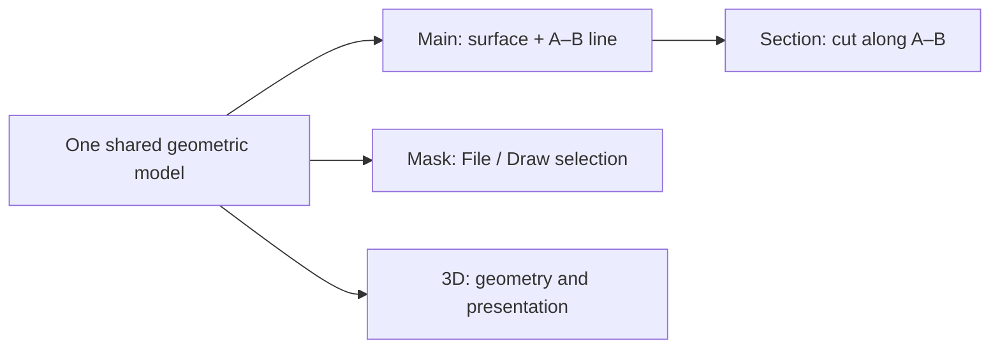

# Workspace and Views

[Home](Home) · [Masks and ROI](Masks-and-ROI)

## Primary views

_Conceptual view relationship (not a screenshot): Main and Section share the same physical coordinates, while Mask decides patterned Process areas and 3D displays the resulting stack._

_A genuine 920 × 600-pixel **Section A–B** output from the shipped MAGIC-1000 representative stack. The horizontal grey Z-break is a **display transformation**, not an air gap. Open this example and switch to 3D to inspect its volume; the small 3D thumbnail was omitted here because it could not explain the material interfaces at instructional scale._

**Find the current controls:** On desktop, the **left sidebar** contains the project title, workflow tabs (**Project**, **Mask**, **Process**, **History**) and the active editor; **Base** is inside Project. The toolbar centered at the top of the right workspace offers **Overview / Main / Mask / 3D / Section**. The sidebar divider can be resized and the sidebar collapsed/restored. On compact screens, the title bar is hidden: the **fixed bottom navigation** switches between **Edit** and **View**, then presents contextual tabs. In compact Edit mode, **Project** contains the return-to-Welcome link. Follow [First 10 Minutes](First-10-Minutes) for the exact editing sequence.

- **Overview** restores Main, Mask, 3D and Section together for quick inspection.
- **Main** is a planar view of the Front/Back surface and provides A–B and 3D ROI editing.
- **Mask** shows either the imported layout (**File**) or local editable primitives (**Draw**). Mask opacity changes visualization, not physical coverage.
- **3D** shows extruded vector structure, rough/pyramid relief, material transparency and ROI cut faces. Switch Fast/Quality for mesh detail.
- **Section A–B** shows the material stack sampled along the chosen A–B path. On desktop it is a peer of Main, Mask and 3D: it can be hidden, restored, arranged or maximized as a scientific view.

## Toolbar states

All four view headers now use explicit **mode selectors** (Mask File/Draw, 3D Fast/Quality and Section Auto/1:1), high-frequency actions, **Display**, **More**, and a conditional maximize action. Main exposes Slice, **3D ROI**, Pan and Fit; Mask exposes **Mask ROI** and Fit. Zoom +/- and export actions are in **More**. Display contains visualization-only controls (Mask opacity; 3D opacity and Border; Section Border). At narrow panel widths, secondary tools move into the _same More menu_ without creating duplicate buttons.

A selected control indicates a persistent state (for example, Pan or Border). An opened editor is an independent state: closing Display never disables Border. Mode labels describe the **current selection**, not a click-to-toggle target. Menus close on Escape, clicking the canvas or completing a one-shot menu action. Section's **Detail ROI** is found in More and is different from Main's 3D ROI or Mask's Process ROI.

## Section geometry and Z exaggeration

**Auto** fits the XY length and Z height independently and reports Z scaling; **1:1** uses a common physical pixel scale. A film that appears wide in Auto may be thin in actual units. Section boundaries use the canonical geometry, while rough/pyramid surface relief is generated as a display field.

### Z-axis break

**Z Break** is in the Section title bar. It opens an editor even when the break is off. **Enable Z-axis break** controls whether the center interval is omitted from the display; the **Upper boundary** and **Lower boundary** fields edit the physical Z values, with material-boundary snapping available on the ruler. **Advanced display scaling** contains the optional linked Front/Back weights; they influence Section Auto and 3D, while **1:1 X:Z** retains its physical scale. Z Break never changes the Kernel geometry or physical exports.

## 3D ROI versus Section A–B

Main ROI clips only the visible 3D inspection volume; it does not constrain Process. Section is evaluated along A–B. The ROI edge and A–B can cross different physical locations, so a 3D sidewall does not necessarily match the Section unless those paths are aligned.

## Visibility

Material opacity controls whether buried regions show through in 3D. Implant and Electrical Region overlays are annotations. A cut face can expose an otherwise buried implant, but that does not mean the original material was removed.

## Performance

Use **Fast** mode or a smaller Main ROI for large repeated arrays or fine rough features. Switching Quality changes only rendering detail, not material geometry, saved project dimensions, or the physical export.
