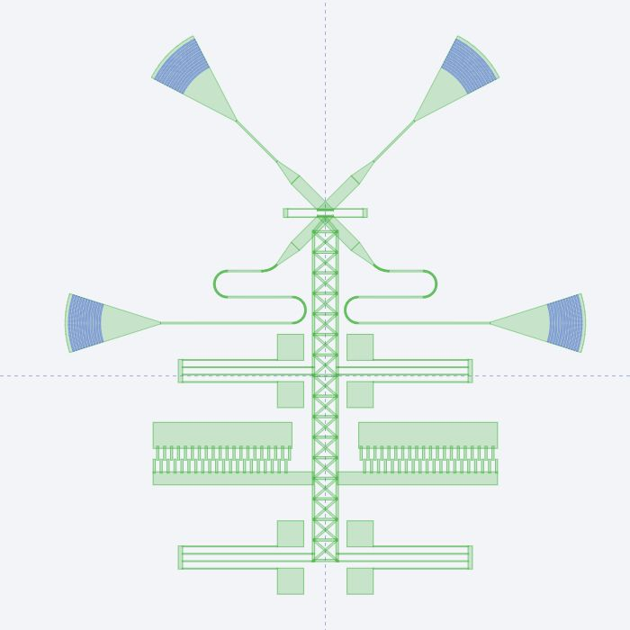
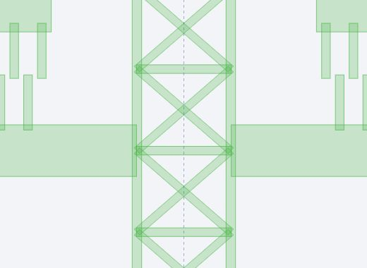

# SWX primary silicon reconstruction

This is an engineering reconstruction of Hu et al., Nature Communications 16, 331 (2025), DOI 10.1038/s41467-024-55528-9. It is not the authors' CAD or a fabrication-qualified mask. All geometry is in physical micrometres. Layer 1/0 is retained 220 nm top silicon, not an etch-opening polarity.

The binary GDS is the review artifact. Run `node scripts/build-swx-s8-mask.mjs` to write it directly from the parametric geometry, then `node --test scripts/swx-s8-primary-silicon.test.mjs` to check dimensions, topology, contacts, motion and the checked-in GDS vertices. There is no SVG conversion step. Inspect the actual GDS in LayoutStudio or KLayout.

## Evidence

Local source: `s41467-024-55528-9.pdf`, Fig. 1c and device-design text; `41467_2024_55528_MOESM1_ESM.pdf`, printed pages 4-12.

| Source        | Geometric constraint                                                                                                                                                             |
| ------------- | -------------------------------------------------------------------------------------------------------------------------------------------------------------------------------- |
| S1, p. 4      | Regular crossing MMI total length 19.54 um, width 2.68 um; each taper 6 um, ending at 0.4 um. The regular cross is rotated 45 degrees and split; each axial MMI half is 9.77 um. |
| S2, pp. 5-6   | SWT period 0.290 um, depth 0.300 um; nominal OFF tip clearance 0.900 um and ON clearance 0.015 um. Mechanical stops are required.                                                |
| S6, p. 9      | Each moving optical lead has two opposite 180-degree turns, R2=3 um, a 15 um middle straight, width 0.4 um, and R1=5 um shoulder transition.                                     |
| S7, pp. 9-10  | Aligner beams 7 um by 0.1 um, truss 1 um. Folded members 30/22 um by 0.2 um, clear beam gaps 1.5 um, return truss 1 um.                                                          |
| S8, p. 10     | Longitudinal 6 um perforated shuttle; paired lateral combs between two spring stations; X-braced bays and open optical chevrons.                                                 |
| S9, pp. 11-12 | Fingers 3.2 by 0.5 um, both lateral clearances 0.3 um, ac=3 um and 40 unit cells total. Interdigitated repeat pitch is 2(0.5+0.3)=1.6 um.                                        |

## Engineering assumptions and limits

Global placement, anchor footprints, spring station spacing, hole/brace geometry, SWT count/phase, mode-converter outlines and the separation of the two fixed signal banks remain inferred. The present 11 teeth per facet and lateral stop positions are engineering choices, not numbers recovered from author CAD. Nominal crossing widths and lengths follow S1; exact optical performance still requires FDTD and mechanical compliance requires FEM.

The inferred 120 nm-wide stop pairs include a 15 nm bump on the moving landing and close after 0.885 um travel; this leaves the source-defined 15 nm optical tip clearance. This is a kinematic constraint, not a simulation of spring deformation. Taper tiles overlap their adjoining geometry by 0.2 nm; internal stroke tiles overlap by 0.1 nm. Flush terminal caps prevent the shuttle attachment from filling the SWT valleys.

The mask envelope is 120 by 128.702144 um including the four illustrative external grating couplers. The envelope is not the 95 by 100 um mechanical-device footprint reported in the paper. It is not a claimed reproduction of the paper's quoted device footprint. The main optomechanical silicon network and two independent fixed-comb networks form three connected groups. Removing the deliberate structural aligners separates stationary and moving optical halves. The fixed banks are not yet connected by a guessed perimeter bus.

Four fan-shaped I/O regions replace the former rectangular endpoint placeholders. Layer 1 contains their silicon envelope and layer 2 contains curved grating trenches. The **22 um radius, 36-degree aperture, 640 nm pitch, 50% duty and 12 grooves are explicitly unvalidated engineering assumptions**; no such grating parameter table was found in the supplied main article or supplement. The trench depth is unassigned. This is a visible topology proposal, not an optically designed or author-equivalent coupler. Mode-converter slab/ridge geometry still requires design.

The former 0.9 um-high spring-anchor placeholders are replaced by 6 um support lands outside the four-beam channels, reflecting the location of solid supports in Fig. 1c and SEM Fig. 3a. Their exact dimensions remain inferred; BOX pedestal survival has not been demonstrated. The stationary and movable comb handles are now 6 um and 3 um wide respectively, as explicitly specified in the main-text discussion of Fig. 2f.

The moving comb handles meet the shuttle side rails at their full 3 um width. The central shuttle remains perforated through this junction, as shown in S8a and SEM Fig. 3a; there is no solid central comb pad or separate narrow connection neck. The optical end uses an open triangular nose instead of a central rectangular post, and the rear rails terminate flush with the closing transverse member. Unsupported external comb terminal blocks and their links have been removed. Brace pitch, rail thickness and exact junction placement remain inferred.

BOX support/release, final ridge/full-etch assignment, Cr/Au pads and their supported routing remain unfinished. Ground/signal metallization must remain off released moving silicon. The yellow background in Fig. 1c is not evidence for a continuous gold ring. This single-cell silicon draft must not be represented as a complete process mask set or released to fabrication.

## Current native GDS view

This is a real LayoutStudio canvas capture of the current binary GDS, not a rendered SVG and not an approved fabrication/optical baseline. The blue arcs are the separate unvalidated grating-trench layer. Source dimensions, inferred geometry and remaining work above govern interpretation.

The second capture shows the junction at higher magnification. Internal tile outlines and darker overlap regions belong to polygons on the same silicon layer; they are not additional masks or independent pads.
